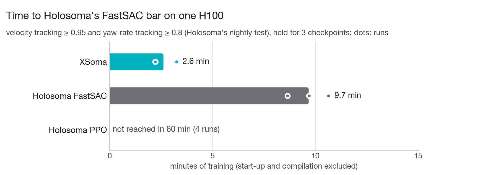
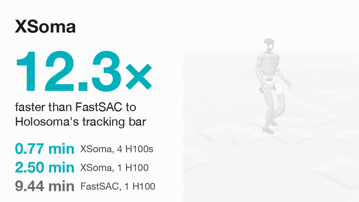
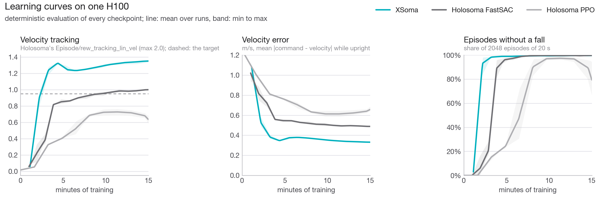

# XSoma

**Humanoid velocity tracking on rough terrain, learned in under three minutes on one GPU.** XSoma trains the Unitree G1
task of [Holosoma](https://github.com/amazon-far/holosoma) with a learned world model: the policy improves by
backpropagating Holosoma's own reward through motions it imagines. On one H100 it reaches Holosoma's own tracking bar
after 2.6 minutes of training, 3.7× sooner than Holosoma's FastSAC. Holosoma's PPO does not reach it within an hour.

Paper: [Learning Humanoid Motion Tracking and Locomotion in Minutes Through Imagination](https://nico-bohlinger.github.io/papers/2026_xmimic_xsoma.pdf)
(Nico Bohlinger, Jan Peters, 2026), which presents XSoma together with [XMimic](https://github.com/nico-bohlinger/xmimic).
Please [cite it](#citation) if you use XSoma.

<picture>
  <source media="(prefers-color-scheme: dark)" srcset="figures/time_to_target_dark.png">
  
</picture>

## What XSoma is

[Holosoma](https://github.com/amazon-far/holosoma) (Amazon FAR) trains a G1 to follow velocity commands, walking forward,
sideways and turning, on randomized rough terrain with PPO or FastSAC. XSoma keeps Holosoma's task and replaces the
learner.

- **The same task.** Holosoma's rewards, terminations, commands, randomization, pushes and terrain, rewritten in JAX and
  checked step by step against Holosoma's own environment ([`tests/test_task_holosoma.py`](tests/test_task_holosoma.py)).
  The policy has Holosoma's observations and actions and the layer sizes of its PPO policy.
- **Learning through imagination.** XSoma learns a world model that predicts how the robot moves. The policy imagines its
  next second of motion in that model and improves by backpropagating Holosoma's reward through it. This is the recipe of
  SuperMimic and [XMimic](https://github.com/nico-bohlinger/xmimic).
- **Everything on the GPU.** The simulator (MuJoCo Warp), the world model and the policy run in JAX as compiled programs,
  so the GPU hardly ever waits for Python.

<p align="center"></p>
<p align="center"><sub>The G1 driven by an XSoma policy after 14 minutes of training on one H100, following a smooth sequence
of velocity commands over Holosoma's rough ground and pits, replayed in MuJoCo.</sub></p>

## Results

Every method trains on one H100 on Holosoma's task, on the half-size terrain that Holosoma recommends for its MuJoCo Warp
backend, and every checkpoint is evaluated the same way.

| method | runs | time to target (min) | speedup | env steps to target | after 15 min: velocity error, falls |
|---|---|---|---|---|---|
| XSoma | 5 | **2.6** (2.2–3.2) | **3.7×** | 5 M | 0.33 m/s, 0.5 % |
| Holosoma FastSAC | 4 | 9.7 (8.6–10.6) | 1.0× | 41 M | 0.49 m/s, 0.4 % |
| Holosoma PPO | 4 | not within 60 | – | – | 0.64 m/s, 10.7 % |

Times are means over runs (range in brackets), in minutes of training with start-up and compilation excluded.

- **The target** is Holosoma's own bar for FastSAC, from its nightly test: a velocity-tracking score of at least 0.95 and a
  yaw-rate score of at least 0.8 in Holosoma's metrics. Here it has to hold for three checkpoints in a row.
- **Better tracking, not only sooner.** After 15 minutes, XSoma's velocity error is a third lower than FastSAC's. FastSAC
  does not get there even at the end of its 50-minute schedule (0.47 m/s).
- **Far fewer simulated steps.** XSoma spends most of its time learning rather than simulating. It reaches the target after
  5 million environment steps, FastSAC after 41 million.
- **PPO** comes closest after about 12 minutes. Then its penalty curriculum, which raises the penalties once the robot stays
  upright, pulls its tracking down for the rest of the hour.

<picture>
  <source media="(prefers-color-scheme: dark)" srcset="figures/learning_curves_dark.png">
  
</picture>

<details>
<summary><b>How we measured</b></summary>

<br>

- **Hardware.** One H100 (95 GB) per run, four runs per node, all on the same cluster.
- **Baselines.** Holosoma at commit `79ba714`, presets `g1_29dof_fast_sac` and `g1_29dof`, unmodified, on its MuJoCo Warp
  backend at terrain scale 0.5 with 4096 robots ([`tools/run_holosoma.sh`](tools/run_holosoma.sh)). FastSAC ran its whole
  schedule (50,000 iterations, about 50 minutes) and PPO one hour of its 25,000 iterations (about 7 hours at this speed).
- **Evaluation.** Every checkpoint of every method drives 2048 robots for one 20-s episode each, with the policy's mean
  action and Holosoma's randomization, pushes and commands, on the same terrain and the same episodes
  ([`xsoma/evaluate.py`](xsoma/evaluate.py)). Holosoma's checkpoints are converted to plain arrays
  ([`tools/holosoma_ckpt.py`](tools/holosoma_ckpt.py)) and run in XSoma's simulator. Holosoma's own logged metrics come
  from its noisy training episodes and are lower.
- **Training time.** XSoma compiles before its clock starts. Holosoma compiles inside its training loop, so the extra time
  of its first logged interval (about 12 s for FastSAC, 0.3 s for PPO) is subtracted from its checkpoint times, as XMimic
  does for BlinkMimic ([`results/README.md`](results/README.md)).
- **Checkpoints.** XSoma and FastSAC save one about every minute of training and PPO about every 1.7 minutes, so the times
  to the target come in steps of about a minute. Three of the five XSoma runs pass at their second checkpoint, two at
  their third.
- **Data.** Every number and figure comes from the files in [`results/`](results/), through
  [`tools/make_figures.py`](tools/make_figures.py). The published runs trained for 60 minutes, and the figures show their
  first 15.

</details>

## How it works

Every iteration does three things, about seven times per second on an H100.

1. **Collect.** 4096 simulated robots take one step each, and the steps go into a replay buffer. Half of the robots add
   exploration noise to the policy's action, the other half act without it.
2. **Learn the world model.** A small network learns to predict the robot's next state from its current state, its action,
   the terrain under its feet and its randomized dynamics, by predicting 8 recorded steps at a time.
3. **Learn the policy, twice.** Starting from recorded states, the policy imagines its next 48 steps, about one second,
   with the world model. Holosoma's own reward and termination functions score every imagined step, with the exact height
   of the terrain under the feet, and the policy follows the gradient of that score back through the imagined motion.

What mattered most:

- **Holosoma's exact reward in imagination.** With the true reward and terrain at every imagined step, one second of
  imagination is enough. XSoma needs no learned reward and no critic, and a critic made tracking slower.
- **Two policy updates per simulated step.** Learning more from every collected step pays off in wall-clock time. Fewer
  updates learned slower and collapsed in some runs.
- **Half of the robots without noise.** When every collected action is noisy, the policy comes to rely on the noise and,
  after about 45 minutes of training, fails without it. Noise-free data keeps every run stable and also reaches the target
  sooner: 2.6 minutes, against 3.2 with a quarter of the robots noise-free and 3.3 with none.
- **Holosoma's FastSAC reward preset.** It rewards staying upright ten times more than the PPO preset, which matters when
  the policy looks only one second ahead. Both presets score tracking the same way.

Why it is fast:

- **The simulator stays on the GPU.** MuJoCo Warp runs Holosoma's whole task step, with physics, rewards, resets and
  pushes, at 250,000 robot steps per second on an H100 ([`tools/bench_sim.py`](tools/bench_sim.py)).
- **Three compiled programs.** Collection, world-model learning and policy learning are compiled XLA programs. Python only
  starts them and reads the logs every 50 iterations.
- **One task, two uses.** The simulator and the imagination call the same JAX functions for kinematics, terrain heights,
  observations, rewards and terminations ([`tools/check_heads.py`](tools/check_heads.py) checks that both give the same
  rewards).

<details>
<summary><b>What did not help</b></summary>

<br>

- A critic, as a bootstrap at the horizon or as λ-returns: slower tracking or unstable training.
- Fewer policy updates per simulated step: slower in wall-clock time and less stable.
- More robots without noise (three quarters): slower on average, and one of four runs collapsed after 12 minutes.
- Holosoma's pushes inside imagination: no fewer falls, and slower tracking.
- A shorter horizon (0.64 s): the policy did not learn to avoid falls.
- A left-right symmetry loss, a survival bonus in imagination, clipping the gradients of exploding imagined motions,
  rejecting updates that lowered the imagined return, a decaying learning rate, collecting with the averaged policy, larger
  or smaller imagined batches, and longer unrolling of the imagination loop: within noise or worse.

</details>

## What we found on the way

These matter for anyone who trains on MuJoCo Warp or with Holosoma's MuJoCo model, with or without XSoma.

1. **MuJoCo Warp's height-map collision breaks down far from the map's center.** Holosoma builds its whole terrain as one
   height map (160 × 240 m at full size). In float32, robots on the outer tiles reach invalid states
   ([`tools/stress_sim.py`](tools/stress_sim.py)), which matches the failure Holosoma's README reports for PPO on MuJoCo Warp
   at full terrain size. XSoma builds one height map per tile, which describes the same surface and is stable everywhere.
2. **Explicit contact pairs ignore friction randomization.** The G1 model binds its sole capsules to the floor with explicit
   contact pairs, which carry their own friction, so randomizing the friction of the geoms leaves the feet at 0.8. XSoma
   turns the pairs into priority contacts with the same parameters, so the soles' friction is randomized as Holosoma
   intends ([`tests/test_scene.py`](tests/test_scene.py)).
3. **Two small mismatches.** The model limits the hip-roll motors to 88 N·m, where Holosoma's config says 139, and the
   height map is stretched by n/(n−1) against the mesh that the foot-height reward reads. XSoma's physics and rewards use
   one surface.

## How to run

Linux with an NVIDIA GPU and CUDA 12, Python 3.11. The published numbers are from H100s.
Warp's wheel on PyPI needs an NVIDIA driver of version 580 or newer. With an older driver, install Warp's CUDA 12 build
(`warp_lang-1.19.0+cu12`) from [its releases](https://github.com/NVIDIA/warp/releases) instead.

```bash
pip install -r requirements.txt
python train.py --log_dir runs/xsoma        # 15 minutes of training, then every checkpoint is evaluated
```

The defaults are the published configuration, and [`xsoma/train.py`](xsoma/train.py) lists every option. Evaluate any run
or checkpoint, XSoma's or Holosoma's:

```bash
python -m xsoma.evaluate runs/xsoma         # 2048 robots, one 20-s episode each, per checkpoint
```

Holosoma's baselines, in Holosoma's own environment (its MuJoCo Warp setup), for 15 minutes of training plus start-up:

```bash
HOLOSOMA=~/holosoma bash tools/run_holosoma.sh runs/fast_sac 17 g1-29dof-fast-sac
HOLOSOMA=~/holosoma bash tools/run_holosoma.sh runs/ppo 17 g1-29dof --training.seed=1
python tools/holosoma_ckpt.py runs/ppo/hs/*/*/model_*.pt    # their checkpoints as plain arrays (needs torch)
python -m xsoma.evaluate runs/ppo                            # back in XSoma's environment
```

Checks, figures and the GIF:

```bash
JAX_PLATFORMS=cpu python tests/test_task_holosoma.py   # XSoma's task against Holosoma's environment (recorded in tests/data)
JAX_PLATFORMS=cpu python tests/test_scene.py           # priority contacts against explicit pairs, tiles against one height map
python tools/check_sim.py                              # kinematics, terrain heights and contact forces against MuJoCo (GPU)
python tools/check_heads.py                            # imagination's rewards and terminations against the simulator's (GPU)
python tools/stress_sim.py                             # physics failures under hard random actions, per terrain layout (GPU)
python tools/bench_sim.py                              # simulator speed (GPU)
python tools/make_figures.py                           # the figures and the table above, from results/
bash tools/download_meshes.sh && python tools/rollout.py ckpt=$(ls runs/xsoma/ckpt/*.npz | tail -1) && python tools/render_gif.py rollout.npz
```

<details>
<summary><b>Faithfulness and caveats</b></summary>

<br>

- **Which Holosoma.** Holosoma's presets default to Isaac Sim. XSoma reproduces Holosoma on MuJoCo (its MJCF, solver
  settings and MuJoCo backends), and both baselines ran Holosoma's MuJoCo Warp backend. Isaac Sim differs in its contact
  model, friction and actuator limits.
- **Where XSoma's simulator differs from Holosoma's MuJoCo Warp backend** (see [What we found on the way](#what-we-found-on-the-way)):
  one height map per tile instead of one for the whole terrain, no n/(n−1) stretch, and in training the soles' friction is
  randomized as Holosoma's config intends. Evaluation keeps the soles at 0.8 for every method, the setting both baselines
  trained in.
- **Falls.** After 15 minutes, 0.5 % of XSoma's evaluation episodes end in a fall, against 0.4 % for FastSAC. In earlier
  runs, most of XSoma's falls came 0.5 to 2 s after one of Holosoma's pushes.

</details>

## Repository

```
train.py           entry point (every option: xsoma/train.py)
xsoma/             task.py (Holosoma's task in JAX), sim.py (MuJoCo Warp simulator), scene.py, terrain.py, kin.py,
                   train.py (world model and imagination), nets.py, buffer.py, optim.py, rot.py, evaluate.py
assets/            Holosoma's G1 MJCF (meshes: tools/download_meshes.sh)
docs/              holosoma_task.md: Holosoma's task, line by line
results/           per-run evaluation files behind every number and figure
figures/           figures and the GIF
tools/             run_holosoma.sh, holosoma_ckpt.py, holosoma_dump.py (baselines and the test data), check_sim.py,
                   check_heads.py, stress_sim.py, bench_sim.py (checks and speed), make_figures.py, rollout.py,
                   render_gif.py, download_meshes.sh (figures and the GIF)
tests/             equivalence tests against Holosoma and MuJoCo (CPU)
```

## Acknowledgements

- **[Holosoma](https://github.com/amazon-far/holosoma)** (Amazon FAR): the task, the robot model and both baselines that
  XSoma reimplements and compares against. Its FastSAC recipe is described in *Learning Sim-to-Real Humanoid Locomotion in
  15 Minutes* (Seo et al., [arXiv:2512.01996](https://arxiv.org/abs/2512.01996)).
- **[XMimic](https://github.com/nico-bohlinger/xmimic)**, and through it [BlinkMimic](https://github.com/fuyichen0725/blinkmimic)
  by Fuyi Chen, [InstantTrack](https://github.com/Huy-Quang-Dao/instantTrack) by Huy-Quang-Dao and
  [supermimic_vibed](https://github.com/zita-ch/supermimic_vibed) by Chong Zhang (ETH Zurich): the world model, the
  policy-learning recipe and much of the training code.
- **SuperMimic** (Liao et al., arXiv:2610.28480) for the method, and **Terrain-Grounded Imagination** (Heyrman and Hutter,
  [code](https://github.com/leggedrobotics/terrain-grounded-imagination)) for grounding imagination in exact terrain lookups.
  XSoma is an independent work, not affiliated with or endorsed by these authors.
- [MuJoCo](https://mujoco.org), [MuJoCo Warp](https://github.com/google-deepmind/mujoco_warp),
  [NVIDIA Warp](https://github.com/NVIDIA/warp) and [JAX](https://github.com/jax-ml/jax).

Licenses and notices of the code and model XSoma derives from: [THIRD_PARTY_NOTICES.md](THIRD_PARTY_NOTICES.md).

## Citation

If you use XSoma in your research, please cite:

```bibtex
@misc{bohlinger2026imagination,
  title  = {Learning Humanoid Motion Tracking and Locomotion in Minutes Through Imagination},
  author = {Bohlinger, Nico and Peters, Jan},
  year   = {2026},
  url    = {https://nico-bohlinger.github.io/papers/2026_xmimic_xsoma.pdf}
}
```

XSoma learns Holosoma's task with SuperMimic's method, so please also cite them (see [Acknowledgements](#acknowledgements)).

## License

XSoma is released under the [MIT License](LICENSE). The parts derived from Holosoma (the task reimplementation and the
bundled G1 MJCF) are under the Apache License 2.0, and the G1 model derives from Unitree's BSD-3-Clause description
(see [THIRD_PARTY_NOTICES.md](THIRD_PARTY_NOTICES.md)).
